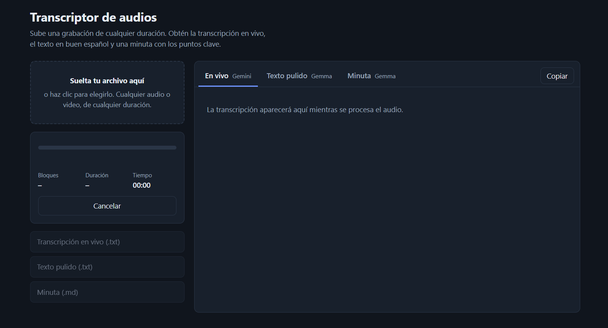
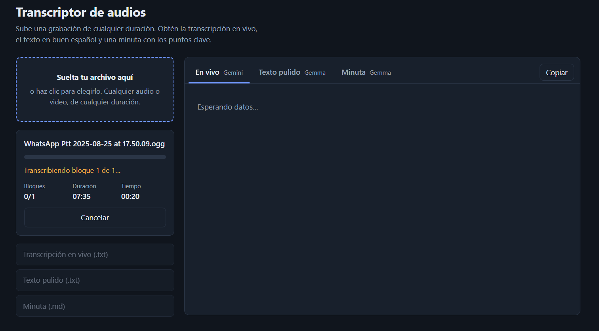

# Transcriptor IA

# Transcriptor IA

Sube un audio (o video) de **cualquier formato y duración** y obtén:

1. **Transcripción en vivo** mientras se procesa (Gemini).
2. **Texto pulido en buen español** (`gemma-4-26b-a4b-it`).
3. **Minuta con puntos clave, decisiones y tareas** (`gemma-4-26b-a4b-it`).

Todo con la **API key de Google** guardada en `.env`; no se descarga ningún modelo local.

> **¿Por qué Gemini y Gemma?** En la API de Google, `gemma-4-26b-a4b-it` procesa texto e imágenes, pero **no audio** 
> (solo las variantes E2B/E4B de Gemma 4 aceptan audio, y no se ofrecen en la API). Por eso el audio lo transcribe un 
> modelo Gemini y todo el trabajo de texto lo hace Gemma.

---

## 📸 Capturas de Pantalla

<p align="center">
  
  
</p>

---

## Flujo

```
audio/video ──ffmpeg──► bloques MP3 de 10 min ──► Gemini (transcribe, streaming) ──► texto crudo
                                                         │
                                                         ▼
                                        Gemma 26B (pule cada bloque, en paralelo)
                                                         │
                                                         ▼
                                  Gemma 26B (minuta; por partes si el texto es enorme)
```

Sin límite de duración: el audio se parte en bloques pequeños, se sube al servidor por streaming y cada bloque
se envía por separado a la API. Una grabación de 5 horas son 30 bloques.

## Estructura

```
transcriptor-ia/
├── .env.example        # plantilla de configuración (copiar a .env)
├── requirements.txt
├── run.py              # arranque: python run.py
├── app/
│   ├── config.py         # lee .env
│   ├── main.py           # FastAPI: subida, SSE en vivo, descargas
│   ├── jobs.py           # trabajos y bus de eventos
│   ├── pipeline.py       # orquestación de todo el proceso
│   ├── audio.py          # ffmpeg: conversión y segmentación
│   ├── gemini_client.py  # cliente Google, streaming y reintentos
│   ├── transcriber.py    # audio → texto (Gemini)
│   ├── polisher.py       # pulido del español (Gemma)
│   ├── summarizer.py     # minuta (Gemma)
│   ├── prompts.py        # todos los prompts
│   └── textutils.py      # utilidades de texto
├── static/               # index.html, styles.css, app.js
├── data/                 # temporales (se borran al terminar)
└── outputs/              # resultados: una carpeta por audio
```

## Instalación

Requisitos: **Python 3.10+** y **ffmpeg** (incluye ffprobe) en el PATH.

```powershell
# ffmpeg en Windows (una vez):  winget install Gyan.FFmpeg      (macOS: brew install ffmpeg | Linux: apt install ffmpeg)

python -m venv .venv
.venv\Scripts\activate          # Linux/macOS: source .venv/bin/activate
pip install -r requirements.txt

copy .env.example .env          # Linux/macOS: cp .env.example .env
```

Abre `.env` y pega tu clave (se obtiene en https://aistudio.google.com/apikey):

```
GOOGLE_API_KEY=tu_clave
```

## Uso

```powershell
python run.py
```

Abre http://127.0.0.1:8000, arrastra el audio y mira cómo avanza. Al terminar, los archivos quedan en
`outputs/<nombre_del_audio>_<id>/`:

| Archivo | Contenido |
|---|---|
| `transcripcion.txt` | Texto pulido (o crudo si `POLISH_ENABLED=0`) |
| `transcripcion_cruda.txt` | Salida directa de Gemini |
| `minuta.md` | Minuta con puntos clave |

## Configuración (`.env`)

| Variable | Por defecto | Descripción |
|---|---|---|
| `GOOGLE_API_KEY` | — | Tu clave de Google AI Studio |
| `TRANSCRIBE_MODEL` | `gemini-flash-latest` | Modelo con soporte de audio |
| `POLISH_MODEL` | `gemma-4-26b-a4b-it` | Pulido del español |
| `SUMMARY_MODEL` | `gemma-4-26b-a4b-it` | Minuta |
| `POLISH_ENABLED` | `1` | `0` omite el pulido |
| `CHUNK_SECONDS` | `600` | Duración por bloque (60–1800) |
| `MINUTA_SINGLE_PASS_CHARS` | `120000` | Sobre este tamaño la minuta se hace por partes |
| `MAX_RETRIES` / `RETRY_BASE_DELAY` | `5` / `4` | Reintentos con espera exponencial (límites de cuota, errores 5xx) |
| `MAX_CONCURRENT_JOBS` | `1` | Audios procesados a la vez |
| `KEEP_TEMP_FILES` | `0` | `1` conserva audio y bloques en `data/` |
| `HOST` / `PORT` | `127.0.0.1` / `8000` | Servidor |

Los nombres de modelos cambian con frecuencia: si ves un error 404 de modelo, revisa la lista vigente en AI Studio.
Google también publicó modelos dedicados de transcripción; puedes probarlos en `TRANSCRIBE_MODEL`, aunque
podrían requerir ajustar `transcriber.py`.

## Notas y límites

- **Privacidad:** el audio se envía a la API de Google. Revisa sus términos antes de procesar contenido sensible.
- **Cuotas:** las claves gratuitas tienen límites por minuto/día; los reintentos automáticos lo absorben, pero un
  audio de muchas horas puede tardar más o agotar la cuota diaria.
- **Cortes entre bloques:** pueden caer a mitad de frase. Cada bloque recibe el final del anterior como contexto y
  la unión de bloques es automática, pero puede quedar algún corte imperfecto.
- **Minuta:** Gemma redacta solo con lo que dice el audio; lo no mencionado aparece como "No especificado".
- **Sin timestamps/SRT:** esta versión entrega texto limpio. Los tiempos que devuelven los LLM no son fiables.
- **Reinicio:** los trabajos viven en memoria; si reinicias el servidor durante un proceso, hay que volver a subir el audio.
- Si cierras la pestaña, el proceso continúa en el servidor y los resultados quedan en `outputs/`.

## Problemas comunes

| Síntoma | Solución |
|---|---|
| Banner "Falta GOOGLE_API_KEY" | Crea `.env` desde `.env.example` y reinicia |
| "No se encontró ffmpeg" | Instálalo y abre una terminal nueva |
| Error 404 de modelo | Corrige el nombre en `.env` |
| Error 429 repetido | Cuota agotada: espera o sube `RETRY_BASE_DELAY` / baja `CHUNK_SECONDS` |
